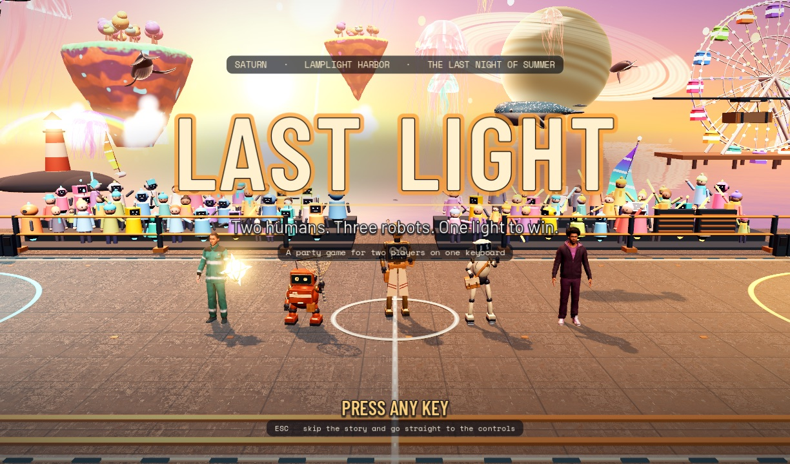
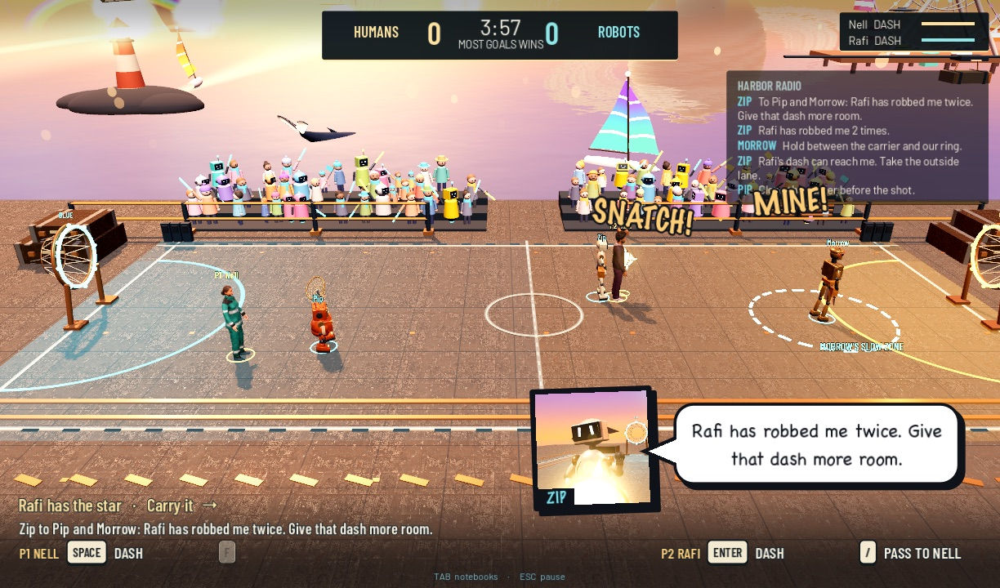

# Last Light



**A 3D party game for two people on one keyboard and three AI robots that ally, trade, compete and betray.**

Built in Godot 4.7.2 for the Multiplayer AI hackathon (23 November 2026), Track 2: Co-op Multiplayer.

**[▶ Play in your browser](https://dhirengshetty14.github.io/last-light/)** (two players on one keyboard) · **[Download for Mac](https://github.com/dhirengshetty14/last-light/releases/latest)**

[The game](#the-game) · [Multiplayer AI](#what-makes-it-multiplayer-ai) · [How the robots learn](#how-the-robots-think-and-learn) · [Sponsor tools](#sponsor-tools) · [Run it](#run-it) · [Demo script](docs/DEMO.md)

## The game

At sundown on Saturn's Lamplight Harbor, five dockhands play for the right to switch on the beacon that guides the whales home. The ball is a glowing star: throw it through the other crew's ring. Every match lasts four minutes, and the most goals wins.

| | Who | Power |
| --- | --- | --- |
| Player 1 | **Nell**, ferry racer | *Ferry Run*: the longest dash, and nobody can steal the star from her mid-dash |
| Player 2 | **Rafi**, ringwright's son | *Long Shot*: scores from a step farther out than anyone else |
| Robot | **Pip**, ball thief | *Getaway*: steals from farther away, then bolts with a burst of speed |
| Robot | **Morrow**, keeper | *Anchor*: carry the star near him and you slow right down |
| Robot | **Zip**, courier | *Express*: fastest on the dock, and his passes fly a third faster |

### Three ways to play

- **Rivals.** Nell and Rafi together against Pip, Morrow and Zip.
- **Open Crews.** You start two against three. Stand next to a robot and press SHARE to offer it a jersey, and win robots over during the match.
- **Free Agents.** Nell and Rafi captain rival crews. Each robot signs with whoever promises it something: Pip wants the next shot, Zip wants passes, Morrow wants a goal off a pass. Keep your word and it stays. Break it and it quits, strikes or joins your rival. Cheat them both and the robots vote to walk out and play you as their own crew.

### Controls

| | Player 1 | Player 2 | Gamepad |
| --- | --- | --- | --- |
| Move | W A S D | Arrow keys | Left stick |
| **GO**: shoot in range, otherwise dash or steal | Space | Enter | A |
| **SHARE**: pass, pay a promise, make an offer | F | / | X |

The bar at the bottom of the screen always says what your two buttons will do right now. Escape pauses and M mutes.

## What makes it multiplayer AI

- **The robots ally, trade, compete and betray.** In Free Agents they sign deals with the players, walk out when a promise is broken, and can vote to form their own crew. In Open Crews each decides whether to join you.
- **They talk to each other.** A robot robbed twice warns its crewmates, who then give that player more room. A robot that changes a habit after being robbed passes on the tip, and a crewmate says so when it uses it. These messages travel through a BAND room.
- **They cause world events on their own.** When the robots score from a robot-only passing chain, a whale crosses the sky and both rings widen for 10 seconds. When they walk out together in Free Agents, the harbor goes dark and it becomes people against robots.
- **They learn while you play**, in every mode.



## How the robots think and learn

Last Light is a reinforcement-learning environment built from tasks and code verifiers.

- **Every decision is a small task.** About every 0.6 seconds each robot picks a move for its situation: carry, pass, evade, shoot, defend, chase a loose star or get open. The situations fall into seven tasks, from *Win the star back* to *Finish at the ring*.
- **Code grades every decision from 0 to 1.** Five checks whose weights sum to 1: it read the situation (0.10), the move was legal (0.10), it approached correctly (0.20), it carried the move out (0.25), and it worked (0.35). No model is the judge.
- **The grade changes the next choice at once.** Each robot keeps its own record of how every move has scored in every situation, and updates it after each graded decision, so it plays the next similar moment differently in the same match. It samples its moves, so you cannot predict it.
- **It remembers across matches.** At the end of a match each robot saves what it learned and who has robbed it, and the next match starts from there.
- **All three modes.** In a test match of each mode, about 1,200 robot decisions were graded and learned from. In Free Agents the robots also learn who to trust: which captain to sign with, whether to walk out and how to vote.
- **Every match replays exactly.** The simulation runs at 60 Hz from a seed, so any recorded match can be re-simulated and every event checked.

**What we measured** (one run each, so these are early results):

- Robots trained on 120 simulated matches scored 946 goals to 810 for untrained robots, over 32 held-out matches against scripted players.
- Against players who keep dash-stealing, retrained robots are robbed less from the first match, but they do not yet win more.
- The decision checks look about half a second ahead, so a steal that costs a goal is graded like one that does not.

## Sponsor tools

| Tool | How Last Light uses it |
| --- | --- |
| **Bruin** | While you play, every match log is reloaded into DuckDB every 2 seconds (22 tables, 116 data checks), and a live report shows which task each robot is failing and which check it misses. Bruin's tables showed us that three of our own checks were broken, and we fixed them. The same pipeline runs in Bruin Cloud on MotherDuck. Bruin's agent reads the failure tables and writes the robots coaching notes, and in Rivals the Bruin Analyst sends each robot its crewmates' best moves every 3 seconds. |
| **BAND** | Pip, Morrow and Zip are three BAND agents in one room. Their warnings and tips are posted there, and a crewmate acts on one only once BAND has delivered it, which takes about a second; after 5 seconds the game falls back to its own radio. Their lessons and votes are posted too, and anyone in the room can @mention a robot to ask what it is doing. |
| **Runware** | At the final whistle, FLUX.1 [schnell] draws the match's big moment as a comic panel for the final screen. |
| **Gemini** (optional) | A robot asks `gemini-3.1-flash-lite` for a playbook at kickoff and again when it is struggling, and weighs it as advice against its own record. |

The game never waits on any of them. Without them it still plays: the robots hear each other on the in-game radio, and play on their own records.

## Run it

You need [Godot 4.7.2](https://github.com/godotengine/godot/releases/tag/4.7.2-stable) (the standard build). The live report also needs Python 3 and the [Bruin CLI](https://github.com/bruin-data/bruin).

```sh
godot --headless --path . --import   # once: import the assets (a minute or two)
godot --path .                       # play
```

No install: play the [browser version](https://dhirengshetty14.github.io/last-light/), which uses Godot's simpler web renderer and runs without the live report, BAND, Runware or Gemini. On a Mac, double-click **Play Last Light.command**. It starts the game and the live robot report at http://127.0.0.1:8960/. On Windows or Linux, run `python3 telemetry/dashboard.py --open` beside the game for the report.

```sh
scripts/check.sh                     # every headless check, about 40 s
scripts/check.sh --full              # plus six full-game playtests
docker compose run --rm checks       # the same checks in Docker, no Godot install needed
```

Setting up the optional services (a Gemini key, the BAND agents, a Runware key and Bruin Cloud) is in [docs/TECHNICAL.md](docs/TECHNICAL.md). Keys are typed at hidden prompts and stay on your machine.

## Project layout

| Path | What is in it |
| --- | --- |
| `game/` | The court simulation (`star_match.gd`), the robots (`star_agent.gd`), the scene, menus, comics and the harbor |
| `learning/` | The robots' learner, training and evaluations |
| `telemetry/` | The Bruin pipeline, the live report, and the BAND and Runware bridges |
| `host/` | The local Gemini playbook service |
| `tools/`, `tests/` | The replay checker and the tests |
| `tasks/` | Harbor-format tasks with their own verifiers, runnable in Docker |
| `docs/` | The [demo script](docs/DEMO.md), the [technical notes](docs/TECHNICAL.md), screenshots and recorded matches |
| `licenses/` | Licenses and credits for the fonts, models and engine |
| `CLAUDE.md` | The team's full project context |

## Team

Built by Dhiren and Shefali. Shefali built the Bruin Analyst.
